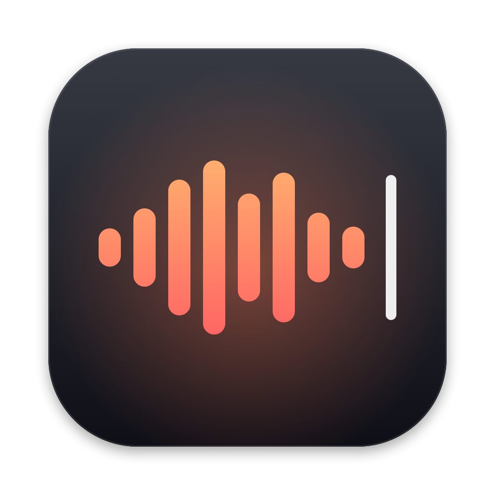
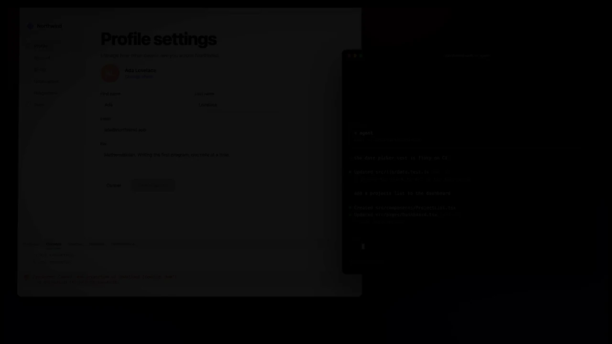

<p align="center">
  
</p>

<h1 align="center">Tack</h1>

<p align="center">
  <b>Talk. Tack screenshots in. Paste into your agent.</b>
</p>

<p align="center">
  A native macOS app that turns what you say, plus the screenshots and copies you make while saying it,<br>
  into one prompt for Claude Code, Codex, Cursor, a terminal or any other app. Transcription runs on your Mac.
</p>

<p align="center">
  <a href="https://github.com/damianpdr/tack/releases/latest"></a>
  
  
  
  
  <a href="LICENSE"></a>
</p>

<p align="center">
  <a href="#install">Install</a> ·
  <a href="#how-it-works">How it works</a> ·
  <a href="#output-format">Output</a> ·
  <a href="#hotkeys">Hotkeys</a> ·
  <a href="#transcription">Transcription</a> ·
  <a href="#history">History</a> ·
  <a href="#privacy-and-data">Privacy</a> ·
  <a href="#development">Development</a>
</p>

<p align="center">
  
</p>

## Highlights

- **One prompt from voice and pictures.** Screenshots, copied text and files land in the transcript exactly where you mentioned them, as `[figure N]`, `[clip N]` and `[file N]`.
- **Private by default.** Parakeet Ultra runs on the Neural Engine. A minute of speech takes about a second, and nothing leaves your Mac.
- **Pastes the right thing.** Terminals and coding agents get markdown with absolute image paths; every other app gets real images followed by the text.
- **Stays out of the way.** A small pill at the bottom of the screen, global hotkeys, tap or hold to talk, and `Esc` to throw it away.
- **Expressive or Minimal.** A warm glow, flying captures and soft sounds, or white bars and quiet fades. You choose in Settings.
- **Searchable history.** Every prompt and screenshot, with keyboard navigation, re-transcription and stacking several items into one prompt.

## Install

1. Download `Tack-<version>.dmg` from the [latest release](https://github.com/damianpdr/tack/releases/latest).
2. Open it and drag **Tack** to **Applications**.
3. Launch Tack and grant the permissions it asks for:
   - **Microphone**: recording.
   - **Accessibility**: pasting with ⌘V into other apps. Without it, the prompt is only copied.
   - **Screen Recording**: Tack's screenshot hotkeys.
4. In *Settings → Transcription*, click *Download* to fetch the Parakeet Ultra model (about 630 MB, once).

Requires macOS 14 or later on Apple Silicon. Releases are signed with a Developer ID and notarized by Apple. Tack checks GitHub Releases for a new version once a day, and on demand from *Check for Updates…* in its menu.

## How it works

1. **Press `⌃⌥R`.** A black pill with a live waveform appears at the bottom of the screen.
2. **Talk.** Take screenshots with `⌃⌥4` (region) or `⌃⌥3` (screen), or copy text, images and files. Each capture flies from where you took it into the pill, and its `figure N` marker appears in the live transcript where you said it.
3. **Press `⌃⌥R` again.** Tack transcribes the audio, puts `[figure N]` / `[clip N]` / `[file N]` markers where the captures happened, and pastes the result into the frontmost app. The same text also stays on the clipboard.

Or hold `⌃⌥R` while you talk and let go to finish; the pill gets a warm rim while you hold. `Esc` or the pill's `×` cancels the recording and discards it.

Tack records from the macOS default input, which switches to AirPods as soon as they connect and lowers their sound quality while they record. To keep using another microphone, pick it in *Settings → General → Recording → Microphone*. While it is unplugged, Tack records from the default input.

### Pointing

Turn on *Settings → General → While recording → Point at things with Control + Option + click* (off by default). While recording, hold Control + Option and click anything on screen: "make this smaller", click, "and this should use the accent colour", click. Each click adds the window under the pointer as a figure, with what you clicked outlined in red, and names it after the figure's path:

```
make this smaller [figure 1] and this should use the accent colour [figure 2]

[figure 1]: /Users/me/.tack/sessions/…/figure-1.png — pointing at heading "Account settings" in Google Chrome, http://localhost:3000/settings
[figure 2]: /Users/me/.tack/sessions/…/figure-2.png — pointing at button "Save changes" in Google Chrome, http://localhost:3000/settings
```

The agent can search the code for the label and knows which page it is on. Outside browsers the window title stands in for the address. The click itself never reaches the app, so pointing at a button doesn't press it. It uses the Accessibility and Screen Recording access Tack already has.

### Pill style

*Settings → General → Pill* offers two styles:

| Expressive (default) | Minimal |
| --- | --- |
| Warm gradient bars and a glow that breathes with your voice | White bars, no glow |
| Captures fly into the pill; the prompt is thrown to your cursor | Plain fades, nothing flies |
| Soft sounds for start, each capture and delivery | No sounds, unless you turn *Play sounds* back on |

With *Reduce motion* on in macOS, captures and prompts never fly, whichever style you pick.

## Output format

This is the text agents and terminals get. It is also what is left on the clipboard and in `prompt.md`:

````
Here is the settings page. [figure 1] Please make the header smaller. [clip 1] That's the error.

[figure 1]: /Users/me/.tack/sessions/2026-09-24_17-27-02/figure-1.png

[clip 1]:
```
TypeError: cannot read properties of undefined
```
````

- Figure and file paths are absolute. A path that contains spaces is wrapped in `<…>`.
- If the only thing captured is one image and nothing was said, the bare image path is pasted.
- A figure added with Control + Option + click ends its line with what it points at. Apps that get the pictures instead of paths get those lines on their own, after the text.

How the paste depends on the frontmost app:

| Frontmost app | What is pasted |
| --- | --- |
| Terminals (Terminal, iTerm, Warp, Ghostty, kitty, WezTerm, Alacritty, Hyper, Tabby), editors and agents (Cursor, VS Code, Zed, MacVim, Claude, Codex, Orca, T3 Code) | The markdown above |
| Any other app | Each image as a picture, then the text with `[figure N]` markers but no path lines |
| Any app, with *Paste mode → Text only* | The markdown above |

Tack always leaves the markdown on the clipboard afterwards. The images and text it puts on the clipboard only to paste them are marked as transient, so clipboard managers keep just that final markdown. Agents can also read the latest prompt directly:

```sh
cat ~/.tack/latest/prompt.md
```

## Hotkeys

| Default | Action |
| --- | --- |
| `⌃⌥R` | Tap to start / stop recording, or hold to talk and release to stop |
| `⌃⌥4` | Region screenshot |
| `⌃⌥3` | Full-screen screenshot |
| `⌃⌥V` | History window |
| `Esc` | Cancel the current recording |
| Control + Option + click | While recording, point at something on screen (when turned on in Settings) |

All of them can be changed in *Settings → General*. The defaults all use `⌃⌥`, which types no characters and is free in window managers like Rectangle and Magnet. Only one app can register each shortcut; if another app already uses one, Settings marks it.

Screenshots taken outside a recording go to the history. macOS's own screenshots (⌘⇧3/4/5) are picked up only if *Capture macOS screenshots saved to disk* is on (off by default). That option watches the system screenshot folder, which can trigger a Desktop access prompt.

## Transcription

### Parakeet (local, default)

- On first launch Tack opens *Settings → Transcription*; click *Download* (about 630 MB, saved to `~/.tack/models/parakeet-ultra/`). After that nothing leaves your Mac.
- Runs [Parakeet Ultra](https://huggingface.co/moondream/parakeet-ultra), moondream's post-training of NVIDIA Parakeet TDT 0.6b v3, on the Neural Engine through [FluidAudio](https://github.com/FluidInference/FluidAudio). It makes fewer mistakes than v3 in every language at the same speed. A minute of speech takes about a second. Tack loads the model in the background when it launches; the first load after an install or update compiles it for the Neural Engine, which can take about 10 seconds.
- Detects the language on its own across 25 European languages, including Polish. Choosing a language only keeps it from writing in another alphabet.
- Transcribes the whole recording in one pass and places markers using word timestamps.
- *Show live transcript in the pill* (on by default) shows the last words you said while recording.
- Vocabulary hints are not used.
- Installs from before Ultra keep transcribing with v3 until you download Ultra in *Settings → Transcription*; the next launch deletes v3.

### OpenRouter (cloud)

- Add an API key in *Settings → Transcription*. Tack keeps it in the macOS keychain. For `tackctl` or a terminal-launched app you can instead export `OPENROUTER_API_KEY`.
- Pick MAI-Transcribe 2 (default), GPT-4o Transcribe or GPT-4o mini Transcribe, or *Custom…* for any other OpenRouter transcription model.
- Audio is split at the capture points, and each part is sent separately. This is how the markers land between sentences.

### Vocabulary

In *Settings → Transcription → Vocabulary*, add project names, components and jargon, e.g. `Supabase`, `Kubernetes`, `useEffect`. Type a term and press Return, or paste a comma-separated list to add many at once. The list is sent to OpenRouter as a hint in `provider.options`: Microsoft MAI gets a `phraseList`; OpenAI and Groq get a `prompt`. Other providers get no hint.

In our tests, MAI-Transcribe 2 spelled every listed term correctly with the hint, and mangled camelCase identifiers into separate words without it. Parakeet does not use the list yet.

### Figure size

*Settings → General → Screenshots in prompts* limits the longest edge of figures attached to a prompt. The default is 2048 px. A Retina full-screen capture (e.g. 6016×3384) is downscaled before it lands in `sessions/…/figure-N.png`. The original stays in the session's `captures/` folder.

## History

Open it with `⌃⌥V` or from the menu bar icon. It lists voice prompts and screenshots, newest first. Screenshots and copies made during a recording are part of that recording's entry, not separate items. Copies made outside a recording are never recorded.

The header shows how much typing your voice notes replaced, at 40 words per minute; each voice note shows its word count and how much faster than typing it was.

| Key | Action |
| --- | --- |
| `↑` / `↓`, `k` / `j` | Move |
| `Return` | Paste into the previously active app |
| `⌘C` | Copy |
| `x` / `Space`, `⌘`/`⇧`-click | Select multiple items |
| `s` | Stack the selected items into one prompt (figures renumbered) |
| `Delete` | Delete |
| `/` | Search |
| `Esc` | Clear the search or selection, or close the window |

*Re-transcribe*, in the detail pane or the context menu, runs a voice item again with the engine currently selected in the toolbar picker. Use it after switching engines or when a transcription failed.

## Privacy and data

- With Parakeet, audio and transcripts never leave your Mac. With OpenRouter, the recorded audio is sent to OpenRouter for transcription.
- Other network requests: the one-time Parakeet model download, OpenRouter's model list when you pick an OpenRouter model, and the daily update check against the GitHub Releases API.
- While recording, Tack skips clipboard items that password managers mark as concealed or transient.
- The OpenRouter key lives in the macOS keychain, not in a file.

Everything else is stored in `~/.tack`. Set `TACK_HOME` to use a different folder.

```
settings.json                        everything except the OpenRouter key
history.sqlite
clips/                               screenshots taken outside recordings
sessions/<yyyy-MM-dd_HH-mm-ss>/      audio.m4a, figure-N.png, prompt.md, transcript.txt, session.json,
                                     captures/ (full-size originals of the figures)
latest -> sessions/…                 the most recent prompt
models/                              the downloaded Parakeet model
```

## Known limitations

- A macOS screenshot whose floating thumbnail is still on screen when you stop recording is not included. Stop after the thumbnail disappears, or turn the thumbnail off in ⌘⇧5 → Options.
- The pill ignores clicks while a recording is being transcribed.
- Pointing names only what an app exposes to Accessibility. On a canvas (Figma, games) or in apps that expose little, the line says "the marked spot" and the window title instead.

## Development

Requires Swift 6.2 or newer. The Command Line Tools are enough; Xcode is not required.

```sh
scripts/build-app.sh            # builds build/Tack.app
scripts/build-app.sh --install  # also replaces /Applications/Tack.app
scripts/test.sh                 # unit tests
swift scripts/make-icon.swift   # regenerates Resources/AppIcon.icns
```

<details>
<summary><b>Local code signing</b> (keeps permissions across rebuilds)</summary>

<br>

macOS ties permissions to the app's signature. An ad-hoc signature changes on every build, so every rebuild loses its permissions. `build-app.sh` signs with the `Tack Local Signing` identity whenever it exists in the keychain. That identity is a self-signed code-signing certificate, created once like this:

```sh
cd "$(mktemp -d)"
printf '[req]\ndistinguished_name=dn\nx509_extensions=ext\nprompt=no\n[dn]\nCN=Tack Local Signing\n[ext]\nbasicConstraints=critical,CA:false\nkeyUsage=critical,digitalSignature\nextendedKeyUsage=critical,codeSigning\n' > cfg
/usr/bin/openssl req -x509 -newkey rsa:2048 -nodes -keyout key.pem -out cert.pem -days 3650 -config cfg
/usr/bin/openssl pkcs12 -export -inkey key.pem -in cert.pem -out id.p12 -passout pass:voice -name "Tack Local Signing"
security import id.p12 -k ~/Library/Keychains/login.keychain-db -P voice -T /usr/bin/codesign
```

You can also sign with any other identity:

```sh
TACK_SIGN_IDENTITY="Apple Development: …" scripts/build-app.sh --install
```

</details>

<details>
<summary><b>CLI</b></summary>

<br>

`tackctl` runs the same transcription pipeline on an existing audio file:

```sh
swift run tackctl transcribe note.wav --engine parakeet --language pl --image 4.2:shot.png --clip 9.0:"some text"
swift run tackctl models   # OpenRouter transcription models
```

</details>

<details>
<summary><b>Releasing</b></summary>

<br>

A release is a signed, notarized DMG attached to a GitHub release. `VERSION` at the repo root is the only place the version lives; `CFBundleVersion` is the commit count. Bumping `VERSION` is the whole version bump.

```sh
scripts/make-dmg.sh           # builds build/Tack-<version>.dmg (Tack.app + /Applications symlink)
scripts/release.sh            # builds the DMG, then prints the gh command
scripts/release.sh --publish  # also runs `gh release create v<version> …`
```

`--publish` refuses to run when the working tree is dirty or the `v<version>` tag already exists.

Signing and notarization take a Developer ID and a `notarytool` keychain profile, stored once:

```sh
xcrun notarytool store-credentials tack --apple-id … --team-id …   # prompts for an app-specific password
TACK_SIGN_IDENTITY="Developer ID Application: … (TEAMID)" TACK_NOTARY_PROFILE=tack scripts/release.sh --publish
```

With a Developer ID identity, `build-app.sh` signs with a secure timestamp and `make-dmg.sh` also signs the disk image. `TACK_NOTARY_PROFILE` makes `make-dmg.sh` submit the DMG with `notarytool submit --wait` and staple the ticket to it. Set without a Developer ID identity, it stops before building, rather than producing a DMG Apple would reject.

</details>

## Credits

- Speech recognition: [Parakeet Ultra](https://huggingface.co/moondream/parakeet-ultra) by moondream, based on NVIDIA Parakeet TDT 0.6b v3 (both CC-BY-4.0), run through [FluidAudio](https://github.com/FluidInference/FluidAudio) (Apache 2.0).

## License

Tack is released under the [MIT License](LICENSE). The speech model and libraries it uses keep their own licenses, listed under [Credits](#credits).
